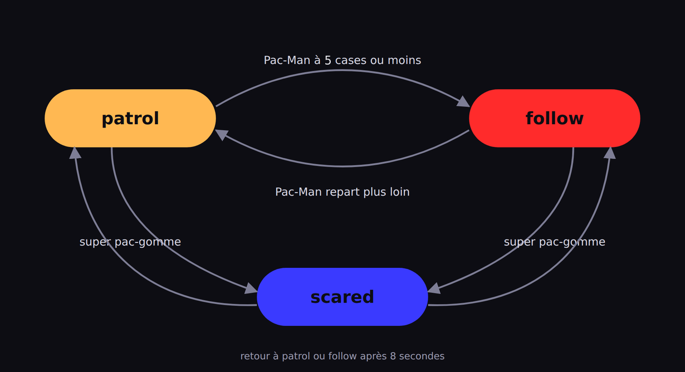

# Partie 2 : Machine à états finis

## Mise en contexte
<!-- ws: {type: prose} -->

Ton fantôme poursuit **tout le temps**, même à l'autre bout de la carte : impossible de le semer
une seconde. Tu vas lui donner trois humeurs.

| `patrol` | `follow` | `scared` |
| --- | --- | --- |
|  |  |  |
| Tu es loin : il erre au hasard. | Tu es proche : il utilise ton arbre de la partie 1. | Tu as mangé une super pac-gomme : il fuit. |

**La couleur du fantôme te dit dans quel mode il est.** C'est comme ça que tu vérifieras ton code
à chaque étape.

> 🛟 **Coincé ?** Les termes propres à cette partie sont dans le glossaire juste en dessous.

<details><summary>Glossaire de la partie 2</summary>

| Terme | Signification |
| --- | --- |
| flèche | Une règle qui fait changer de mode : un `if` qui change `state`. Sur le diagramme de l'étape 0, chaque flèche part d'un mode et arrive dans un autre |
| `state` | La variable où tu ranges le mode : `'patrol'`, `'follow'` ou `'scared'`. Le jeu la lit après chaque appel de `ghost` et colore le fantôme |
| `'patrol'` | Le fantôme erre au hasard (orange) |
| `'follow'` | Le fantôme utilise l'arbre de décision de la partie 1 (rouge) |
| `'scared'` | Le fantôme fuit (bleu) |
| super pac-gomme | Grande pac-gomme blanche dans les 4 coins, effraie le fantôme 8 secondes |
| `game.scaredTimer` | Temps restant de la super pac-gomme (supérieur à 0 = peur active) |
| `totalDistance` | Tu le calcules : le nombre de cases entre le fantôme et Pac-Man |
| `me.direction` | La direction que le fantôme suit en ce moment, `nil` s'il est arrêté. Sert au bonus **Tenir sa direction** |
| `compteur` | Une variable à toi qui compte les cases depuis le dernier virage. Sert au bonus **Tenir sa direction** |

</details>

## Étape 0 : L'état du fantôme
<!-- ws: {type: exercise, id: a2-etat-patrol, points: 150} -->

Une **machine à états finis** est dans un seul mode à la fois, et elle en change quand un événement arrive.



Ce diagramme est le plan de toute la partie. Chaque bulle est un **mode**. Chaque **flèche** est une règle qui fait changer de mode.

Le mode est rangé dans une variable : `state`.

> ⚠️ **Une seule exception à la règle de la partie 1.** `state` s'écrit **au-dessus** de `function ghost()`, pas dedans. Tout le reste s'écrit toujours entre `function` et `end`.

Pourquoi ? Le jeu appelle `ghost` à chaque case. Une ligne écrite dedans repasse à chaque case, et le fantôme oublierait son mode à chaque pas. Au-dessus, elle ne passe qu'une fois, au démarrage.

### Le plan de ton fichier

Toute la partie 2 se range dans ces quatre zones, toujours dans cet ordre :

```lua
state = 'patrol'   -- ① la mémoire du fantôme : AU-DESSUS de function

function ghost()
  -- ② tes variables : canGoLeft, distanceX... (partie 1)
  -- ③ les flèches : les règles qui changent state
  -- ④ les comportements : comment bouger dans chaque mode
end
```

Aujourd'hui, la zone ③ est vide et la zone ④ contient ton arbre de la partie 1. Chaque étape te dira dans quelle zone écrire.

### 🥸 Mise en application
<!-- ws:doit -->

**Ton objectif :** créer la variable `state`, et vérifier que le jeu la lit.

1. Ajoute la ligne ① tout en haut de ton fichier, **au-dessus** de `function ghost()`.
2. Lance : le fantôme te poursuit comme avant, mais il est **orange**. C'est son humeur de départ.
3. Remplace `'patrol'` par `'follow'` et relance : il devient **rouge**. Remets `'patrol'`.


<!-- ws: {type: hint} -->
<details><summary>Si tu es bloqué</summary>

- **Il garde sa couleur d'avant ?** Regarde où est ta ligne : elle doit être **au-dessus** de la ligne `function ghost()`, pas en dessous, et pas après le `end`.
- **Il ne devient pas rouge ?** Comme pour les directions : des guillemets, en anglais, en minuscules.

</details>

## Étape 1 : Devenir bleu
<!-- ws: {type: exercise, id: a2-devenir-bleu, points: 200, validation: quiz} -->

Les quatre grosses pac-gommes blanches, dans les coins, sont des **super pac-gommes**. Quand tu en manges une, `game.scaredTimer` passe à 8 et redescend seconde après seconde. Au-dessus de 0, le fantôme a peur.

Dans cette étape, tu écris **seulement les deux flèches** de `scared` : celle qui y entre, celle qui en sort. Le fantôme changera de couleur, mais il bougera encore comme avant. La fuite, c'est l'étape suivante.

<!-- ws:toolbox -->
### Boîte à outils

> 🧰 **Outil #1 : `==` demande « est-ce exactement ça ? »**
> Un seul `=` stocke une valeur ; deux `==` posent une question.
> ▶️ **Essaye dans la Console :**
> ```lua
> motDePasse = 'secr3t'
> if motDePasse == 'secr3t' then
>   print('Accès autorisé')
> else
>   print('Mot de passe incorrect')
> end
> ```
> 📘 [Les opérateurs relationnels](https://www.lua.org/manual/5.3/manual.html#3.4.4)

> 🧰 **Outil #2 : une flèche, c'est un `if` qui change la mémoire**
> Un téléphone a deux modes : `'normal'` et `'économie'`. Une flèche n'envoie aucune direction : elle change seulement le mode.
> ▶️ **Essaye dans la Console :**
> ```lua
> mode = 'normal'
> batterie = 15
> if batterie < 20 then
>   mode = 'économie'
> end
> if mode == 'économie' and batterie > 50 then
>   mode = 'normal'
> end
> print(mode)
> ```
> Tu lis `économie`. Mets `batterie = 80` à la place de `15`, relance : tu lis `normal`.
> La deuxième flèche part du mode `'économie'` : elle vérifie d'abord **d'où** elle part, puis l'événement.
<!-- /ws:toolbox -->

### 🥸 Mise en application
<!-- ws:doit -->

**Ton objectif :** un fantôme qui devient **bleu** quand tu manges une grosse pac-gomme blanche, et qui redevient **orange** quand la peur est finie.

Dans la zone ③, sous tes variables, les deux flèches :

```lua
-- zone ③ : les flèches
if nil then -- remplace nil : quand le fantôme prend-il peur ?
  state = 'scared'
end
if nil then -- remplace nil : quand sa peur est-elle finie ?
  state = 'patrol'
end
```

Pose-toi les bonnes questions :
- Que vaut `game.scaredTimer` pendant la peur ? Et après ?
- La flèche de sortie part de la bulle `scared` : que doit-elle vérifier en premier ?

*C'est réussi si :*
- tu manges une super pac-gomme : il devient **bleu** (il te poursuit encore, c'est normal) ;
- 8 secondes plus tard, il redevient **orange**.

<!-- ws: {type: hint} -->
<details><summary>Si tu es bloqué</summary>

- **Jamais bleu ?** Ajoute `print(game.scaredTimer)` dans la zone ②, lance, mange une super pac-gomme, et regarde la **Console**. Relis ta première condition avec ces nombres.
- **Bleu pour toujours ?** Regarde dans la **Console** ce que vaut `game.scaredTimer` quand la peur est finie. Relis ta deuxième condition avec ce nombre.
- **Une erreur rouge sur la ligne d'un `if` ?** Dans une condition, on pose une question : deux `==`, pas un seul.

</details>

<!-- ws: {type: quiz, id: a2-devenir-bleu-1, kind: single} -->
> Dans quelle condition le fantôme passe en mode `scared` ?
- A. Quand `game.scaredTimer > 0`
- B. Quand `game.scaredTimer == 0`
- C. Quand `game.scaredTimer < 0`
- D. Quand Pac-Man s'approche de lui

## Étape 2 : Fuir
<!-- ws: {type: exercise, id: a2-peur-fuite, points: 350, validation: quiz} -->

Ton fantôme devient bleu, mais il te fonce encore dessus. Il lui faut sa propre façon de bouger quand il a peur.

### 🥸 Mise en application
<!-- ws:doit -->

**Ton objectif :** le même fantôme bleu, mais qui **s'écarte** de toi, et que tu peux attraper sans mourir.

Dans la zone ④, **au-dessus** de ton arbre de la partie 1 :

```lua
-- zone ④ : les comportements, scared en premier
if state == 'scared' then
  -- tes règles de fuite
end
-- puis ton arbre de la partie 1, sans y toucher
```

Tes règles de fuite ressemblent à tes quatre règles de poursuite. **Une seule chose change** :

| Pac-Man est... | Pour le poursuivre | Pour le fuir |
| --- | --- | --- |
| à gauche (`distanceX < 0`) | gauche | ? |
| à droite (`distanceX > 0`) | droite | ? |
| au-dessus (`distanceY < 0`) | haut | ? |
| en dessous (`distanceY > 0`) | bas | ? |

**Teste au milieu :** écris une seule règle de fuite, relance et mange une super pac-gomme. Quand tu es du bon côté, il doit s'écarter. Ensuite seulement, écris les trois autres.

Tu dois obtenir ceci :


<!-- ws: {type: hint} -->
<details><summary>Si tu es bloqué</summary>

- **Bleu, mais il te fonce toujours dessus ?** Ton bloc `scared` arrive trop tard. Souviens-toi de l'étape 6 de la partie 1 : le premier `return` lu l'emporte.
- **Il fuit du mauvais côté ?** Relis ce que veulent dire `distanceX > 0` (étape 3 de la partie 1) et `distanceY > 0` (étape 5).
- **Il traverse les murs en fuyant ?** Chaque règle de fuite a besoin de son `canGo...`, comme en partie 1.

</details>

Il s'arrête, ou se rapproche de toi, alors qu'il a peur ? Il est peut-être acculé : toutes les cases libres le rapprochent de toi, donc aucune de tes règles de fuite ne s'applique. Ce n'est pas une erreur dans ton code.


<!-- ws: {type: quiz, id: a2-peur-fuite-1, kind: single} -->
> Lorsque le fantôme a peur et Pac-Man est à droite, où doit aller le fantôme ?
- A. En bas
- B. À droite
- C. À gauche
- D. En haut

<!-- ws: {type: quiz, id: a2-peur-fuite-2, kind: single} -->
> Dans quel ordre doit s'exécuter ton code pour que ton fantôme ait le bon comportement ?
- A. Vérifier si le fantôme a peur. S'il a peur : fuir, sinon : se rapprocher.
- B. Se rapprocher. Vérifier si le fantôme a peur, s'il a peur : fuir.
- C. L'ordre d'exécution du code n'a pas d'importance

## Étape 3 : Errer au hasard
<!-- ws: {type: exercise, id: a2-patrouiller, points: 400} -->

En `'patrol'`, le fantôme ne te cherche pas. À chaque case, il regarde les directions libres et en tire une au hasard.

Ça donne un fantôme qui **ne va nulle part en particulier** : il tourne autour de son point de départ au lieu de traverser la carte.

<!-- ws:toolbox -->
### Boîte à outils

> 🧰 **Outil #1 : construire une liste petit à petit**
> `{}` crée une liste vide, `table.insert` y ajoute un élément à la fin.
> ▶️ **Essaye dans la Console :**
> ```lua
> glaceDispo = true
> gateauDispo = false
> cookieDispo = true
> desserts = {}
> if glaceDispo then table.insert(desserts, 'glace') end
> if gateauDispo then table.insert(desserts, 'gâteau') end
> if cookieDispo then table.insert(desserts, 'cookie') end
> ```
> Tape ensuite `desserts[1]` dans la **Console** : tu lis `glace`.
> 📘 [table.insert](https://www.lua.org/manual/5.3/manual.html#pdf-table.insert)

> 🧰 **Outil #2 : tirer au hasard dans une liste**
> `#liste` donne le nombre d'éléments, `math.random(1, n)` tire un entier entre 1 et n inclus.
> À taper juste après l'outil #1 : il se sert du `desserts` que tu viens de construire.
> ▶️ **Essaye dans la Console :**
> ```lua
> index = math.random(1, #desserts)
> return desserts[index]
> ```
> **En Lua, les listes commencent à 1**, pas à 0.
> 📘 [math.random](https://www.lua.org/manual/5.3/manual.html#pdf-math.random) · [l'opérateur #](https://www.lua.org/manual/5.3/manual.html#3.4.7)
<!-- /ws:toolbox -->

### 🥸 Mise en application
<!-- ws:doit -->

**Ton objectif :** un fantôme qui se déplace de manière aléatoire.

Dans la zone ④, un bloc `if state == 'patrol' then`, **sous** le bloc `scared` et **au-dessus** de ton arbre de la partie 1. Dedans, quatre temps :

1. une liste vide, que tu peux appeler `possibleDirections`. Elle s'écrit **dans** le bloc : elle doit repartir de zéro à chaque case.
2. remplis-la avec les directions libres, en te servant de tes `canGo...` de la partie 1.
3. **teste au milieu** : renvoie le **premier** élément de ta liste, comme `desserts[1]`. Le fantôme doit partir dans une direction libre, sans traverser de mur.
4. remplace ce premier élément par un tirage au hasard.

Tu dois obtenir ceci : il erre sans traverser un seul mur, et il ne te poursuit plus du tout, même collé à toi. C'est voulu et c'est temporaire : la poursuite revient à l'étape 4, en mieux.


<!-- ws: {type: hint} -->
<details><summary>Si tu es bloqué</summary>

- **Ta liste se construit-elle ?** `print(#possibleDirections)` juste avant le tirage, et regarde le panneau **Console**, sous l'éditeur. Si le nombre reste à 0, le problème est dans la construction de ta liste, pas dans le tirage. (Et tu risques d'avoir une erreur qui s'affiche.)
- **Le nombre grandit à chaque case ?** Ta liste vide est écrite au-dessus de `function ghost()` : elle ne repart jamais de zéro. Déplace-la dans le bloc `patrol`.
- **Il te poursuit encore, comme avant ?** Alors ton bloc `patrol` n'est jamais atteint : vérifie que `state = 'patrol'` est bien en haut de ton fichier (étape 0), et que ton bloc s'écrit `state == 'patrol'`, avec deux `=`.
- **Il traverse les murs ?** Tu as mis les quatre directions dans la liste sans les filtrer. Mets uniquement les directions libres dans ta liste.

</details>

## Étape 4 : Poursuivre seulement quand tu es proche
<!-- ws: {type: exercise, id: a2-mode-follow, points: 400} -->

Tu as les trois comportements, et les deux flèches de `scared`. Il manque les deux flèches entre `patrol` et `follow` : proche, il passe en `follow` ; loin, il revient en `patrol`.

« Proche » se mesure en **cases** : l'écart horizontal **plus** l'écart vertical. Le seuil est de **5 cases**.

<!-- ws:toolbox -->
### Boîte à outils

> 🧰 **Outil #1 : `math.abs` retire le signe**
> ▶️ **Essaye dans la Console :**
> ```lua
> print(math.abs(5))    -- 5
> print(math.abs(-5))   -- 5
> ```
> Que Pac-Man soit trois cases à gauche ou trois cases à droite, il est à trois cases.
> *(Si tu as fait l'étape 7 de la partie 1, tu le connais déjà.)*
> 📘 [math.abs](https://www.lua.org/manual/5.3/manual.html#pdf-math.abs)

> 🧰 **Outil #2 : `<=` « plus petit ou égal »**
> `a < b` est faux quand `a` vaut exactement `b`. `a <= b` est vrai dans ce cas.
> ▶️ **Essaye dans la Console :**
> ```lua
> age = 15
> if age <= 17 then
>   return 'tarif jeune'
> end
> ```
> 📘 [Les opérateurs de comparaison](https://www.lua.org/manual/5.3/manual.html#3.4.4)

<!-- /ws:toolbox -->

### 🥸 Mise en application
<!-- ws:doit -->

**Ton objectif :** un fantôme qui patrouille quand tu t'éloignes, et te repère quand tu reviens.

Tes règles de déplacement ne changent pas : ton arbre de la partie 1 **est** le comportement `follow`. C'est ce qui reste quand le fantôme n'est ni `scared` ni `patrol`.

**1. Mesurer** (zone ②, sous `distanceY`) : une variable `totalDistance`, la distance en cases.

**Teste au milieu :** `print(totalDistance)`, lance, et rapproche Pac-Man du fantôme. Dans la **Console**, le nombre doit descendre vers 0, sans jamais devenir négatif.

**2. Les deux flèches** (zone ③, sous les flèches de `scared`) :
- de `patrol` vers `follow` : quand `totalDistance` descend à 5 ou moins ;
- de `follow` vers `patrol` : quand tu t'éloignes.

Comme la sortie de `scared`, chaque flèche vérifie d'abord **d'où** elle part.

Tu dois obtenir ceci : **orange** de loin, **rouge** à 5 cases ou moins, orange à nouveau quand tu t'éloignes. En rouge, le jeu le fait aussi accélérer un peu : ça ne vient pas de ton code.


<!-- ws: {type: hint} -->
<details><summary>Si tu es bloqué</summary>

Orange en permanence ? `print(totalDistance)` juste après l'avoir calculée, et regarde le panneau **Console** : en te rapprochant, le nombre doit descendre vers 0 en restant **positif**. S'il devient négatif, il te manque la valeur absolue.

Orange en permanence, et `totalDistance` descend bien sous 5 ? Une autre flèche remet peut-être `state` à `'patrol'` à chaque case. Ta flèche de sortie de `scared` vérifie-t-elle que le fantôme **est** en `scared` ?

Rouge en permanence ? Il te manque la flèche du retour : il entre en `'follow'` et rien ne l'en fait ressortir.

Plus jamais bleu quand il est rouge ? Ta flèche vers `'scared'` part sûrement de `'patrol'` seulement. Sur le diagramme elle part **des deux** modes : elle ne teste pas `state`, seulement `game.scaredTimer`.

Rouge mais immobile ? Ton arbre de la partie 1 est resté **dans** le bloc `patrol`, au lieu d'être en dessous.

</details>

## Étape 5 : Le fantôme complet
<!-- ws: {type: exercise, id: a2-fantome-complet, points: 300} -->

Tes trois modes existent séparément. Reste à voir s'ils s'enchaînent proprement.

### 🥸 Mise en application
<!-- ws:doit -->

**Ton objectif :** retrouver les six comportements ci-dessous.

| Ce que tu fais | Ce que tu dois voir |
| --- | --- |
| Tu restes à l'autre bout de la carte | **orange**, il erre au hasard sans te chercher |
| Tu approches à 5 cases ou moins | **rouge**, il accélère et fonce sur toi |
| Tu manges une grosse pac-gomme blanche | **bleu**, il s'écarte pendant 8 s |
| Tu le touches en bleu | tu l'attrapes : il repart à l'autre bout de la carte |
| Tu le touches en orange ou rouge | tu meurs, ça redémarre après 3 s |
| À tout moment | il ne traverse aucun mur |

Et si tu veux la gagner en entier, 211 pac-gommes et un score de **2 270** :


<!-- ws: {type: hint} -->
<details><summary>Si tu es bloqué</summary>

Ajoute `print(state)` à la fin de la zone ③, juste avant tes comportements. La **Console** te dit dans quel mode le fantôme croit être, à chaque case. Puis va revoir l'étape qui correspond à ce que tu vois :

| Ce que tu vois | Va revoir |
| --- | --- |
| Jamais bleu, ou bleu pour toujours | l'étape 1 |
| Bleu, mais il te fonce dessus | l'étape 2 |
| Orange, mais il te poursuit | l'étape 3 |
| Jamais rouge, ou rouge pour toujours | l'étape 4 |

</details>

## Bonus : Tenir sa direction
<!-- ws: {type: exercise, id: a2-tenir-direction, points: 250, optional: true} -->

En mode `patrol`, ton fantôme erre, mais il ne va nulle part : à chaque case il retire aléatoirement une direction, et une fois sur quatre c'est un demi-tour.

Il lui faut garder sa direction quelques cases au lieu de changer à chacune. Le jeu appelle `ghost` **à chaque case**, donc compter les appels, c'est compter les cases.

Deux outils : `me.direction`, la direction que le fantôme suit en ce moment, et une variable à toi, `compteur`, qui augmente de 1 à chaque appel.

La règle à poser **avant** ton tirage au hasard : si `compteur < 5` **et** que la case devant est libre, continue dans `me.direction`. Sinon, remets `compteur` à 0 et tire.

<!-- ws:toolbox -->
### Boîte à outils

> 🧰 **Outil #1 : une variable qui survit d'un appel à l'autre**
> Écris-la **en dehors** de la fonction, tout en haut de ton fichier : la ligne qui la met à `0` ne passe alors qu'une seule fois, et la variable garde sa valeur d'un appel au suivant. Mets cette même ligne **dans** la fonction et elle repasse à chaque appel : la variable revient à `0` à chaque case.
> ▶️ **Essaye dans la Console :**
> ```lua
> nombreDeVisites = 0
> function visite()
>   nombreDeVisites = nombreDeVisites + 1
> end
> ```
> Appelle `visite()` trois fois dans la **Console**, puis tape `nombreDeVisites` : tu lis `3`.
> 📘 [Les variables](https://www.lua.org/manual/5.3/manual.html#3.2)
<!-- /ws:toolbox -->

### 🥸 Mise en application
<!-- ws:doit -->

**Ton objectif :** un fantôme qui tient sa direction cinq cases d'affilée, et qui traverse donc vraiment la carte.

1. En haut du fichier, à côté de `state` : `compteur = 0`
2. Dans ton bloc `patrol`, la règle ci-dessus **avant** le tirage au hasard, et `compteur = compteur + 1` juste avant elle

`me.direction` vaut `'left'`, `'right'`, `'up'`, `'down'`, ou `nil` au premier appel et quand il est arrêté.

Tu dois obtenir ceci :


*C'est réussi si :* il file en ligne droite sur plusieurs cases avant de tourner.

## Bonus : Ton fantôme à toi
<!-- ws: {type: exercise, id: a2-ton-fantome, points: 200, optional: true, requires: a2-patrouiller} -->

*Tu es arrivé au bout, les trois modes s'enchaînent. Ce qui suit n'est plus un exercice : c'est ta récompense, et c'est la partie que personne ne fait pareil.*

Ton fantôme marche, mais ses réglages sont ceux qu'on t'a donnés. Son caractère tient dans ces trois lignes du tableau : deux nombres et un ordre :

| Ce que tu changes | Ce que ça donne |
| --- | --- |
| le seuil des 5 cases | un fantôme myope, ou un qui te repère de l'autre bout de la carte |
| l'ordre des règles dans `follow` | poursuivre ou essayer de te couper la route |
| le nombre auquel tu compares `compteur`, si tu as fait le bonus **Tenir sa direction** | `5` le laisse tenir cinq cases ; `2` le fait tourner deux fois plus souvent |

Un seul de ces nombres suffit à changer son caractère. Même trajet de Pac-Man, deux fantômes opposés :


### 🥸 Mise en application
<!-- ws:doit -->

**Ton objectif :** un fantôme qui te ressemble, et une partie jouée contre lui.

1. Écris son caractère en trois phrases, **en français**. Par exemple : *« Il ne me voit que de très près. Mais dès qu'il me voit, il coupe au plus court. Et il ne lâche plus. »*
2. Traduis chaque phrase en un réglage, et donne-lui un nom.
3. Lance, joue trente secondes : ta description se vérifie-t-elle à l'écran ?

<!-- ws: {type: hint} -->
<details><summary>Si tu es bloqué</summary>

Tu ne vois pas quoi changer ? Prends le seuil, et uniquement lui. Mets-le à `2`, joue trente secondes. Mets-le à `30`, rejoue.

Ton fantôme ne ressemble pas à ta description ? Change **un** réglage à la fois et relance entre chaque. À deux changements d'un coup, on ne sait plus lequel a fait quoi.

</details>

## Défis bonus - Partie 2
<!-- ws: {type: exercise, id: a2-bonus, points: 150, optional: true} -->

Trois variantes de ta machine à états.

### Défi #1 : L'opportuniste

Dans ta flèche de sortie de `'scared'`, ne le laisse pas avoir peur jusqu'au bout : dès que `game.scaredTimer` descend sous 2, remets-le en chasse sans attendre la fin des 8 secondes.

*C'est réussi si :* il repasse au rouge **avant** que la super pac-gomme soit épuisée.

### Défi #2 : Le fantôme rancunier

En `scared`, ne fuis que si tu es proche : au-delà de 10 cases, il n'a plus peur de toi et repart en patrouille, même bleu.

*C'est réussi si :* colle-toi à lui, il s'écarte ; éloigne-toi de dix cases, il se remet à errer au hasard sans t'éviter.

### Défi #3 : Le fantôme imprévisible

Combine les deux modes : en `patrol`, fais-le foncer sur toi une fois de temps en temps, au hasard, même si tu es loin.

*C'est réussi si :* il t'arrive de le voir charger depuis l'autre bout de la carte.

## Fin de la partie 2

Ton fantôme sait patrouiller, poursuivre et prendre peur. Trois humeurs, trois couleurs, et c'est toi qui as écrit les règles de chacune.

Tu as utilisé deux façons de programmer un comportement : un arbre de décision, puis une **machine à états**. Ce qui sépare les deux tient dans un seul mot, `state` : ton fantôme se souvient de ce qu'il est en train de faire, et c'est ce souvenir qui décide de la suite.
